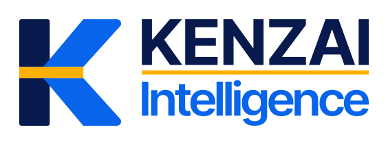

  <a href="https://kenzai.io">
    <picture>
      <source media="(prefers-color-scheme: dark)" srcset="assets/kenzai-lockup-reverse.svg" />
      <source media="(prefers-color-scheme: light)" srcset="assets/kenzai-lockup-primary.svg" />
      
    </picture>
  </a>

<h1 align="center">
  Decisions Layer
</h1>

  Your existing systems. Connected business context. AI co-workers that help move work forward.

  <a href="https://kenzai.io"><strong>Website</strong></a>
  ·
  <a href="https://kenzai.io/services"><strong>Explore Kenzai</strong></a>
  ·
  <a href="https://kenzai.io/how-we-work"><strong>How we work</strong></a>
  ·
  <a href="https://kenzai.io/security-and-governance"><strong>Security</strong></a>
  ·
  <a href="mailto:hello@kenzai.io"><strong>Contact</strong></a>

---

## AI that works with your business context

Work is spread across documents, email, conversations, projects, and business applications. The context needed to move it forward is spread across those systems too.

Kenzai is an AI co-worker platform designed to work across the systems your company already uses. It brings approved knowledge, connected tools, and workflows into one workspace, giving AI the context to understand a request and help carry the work through.

**Existing systems → Connected context → AI co-workers → Coordinated action**

## How it fits together

1. **Connect your systems.** Bring the tools and information your team uses into a shared working context through authorized connections.
2. **Understand the work.** Connect relevant documents, conversations, tasks, and decisions so requests have the business context they need.
3. **Move work forward.** Help people find answers, prepare documents and replies, coordinate tasks, and follow through across connected workflows.
4. **Keep people in control.** Respect source permissions, make proposed actions visible, and retain human judgment at the decisions that matter.

## Designed for everyday business work

- **Company knowledge:** find the relevant information and the sources behind it.
- **Documents and communication:** prepare briefs, drafts, and replies using the context of the work.
- **Projects and coordination:** turn conversations into clear next steps and keep related work connected.
- **Business workflows:** bring information and actions together across teams and their existing tools.

The starting point is one useful workflow. Connect the right sources, establish the controls, and expand as the team proves value.

## Our product principles

- Company context comes from the sources a person is authorized to use.
- Existing business systems remain the source of truth for the records they own.
- AI actions should be understandable, traceable, and accountable.
- Important decisions stay with responsible people.
- Reliability, permissions, and recovery are part of the product.

## Working with us

Most of our product and client delivery repositories are private. Public repositories and technical resources will appear here when they are ready for external use.

To explore Kenzai for your team, visit [kenzai.io](https://kenzai.io) or email [hello@kenzai.io](mailto:hello@kenzai.io).

---

  <picture>
    <source media="(prefers-color-scheme: dark)" srcset="assets/kenzai-mark-reverse.svg" />
    <source media="(prefers-color-scheme: light)" srcset="assets/kenzai-mark-primary.svg" />
    
  </picture>

AI that moves the work forward while people stay in control.

