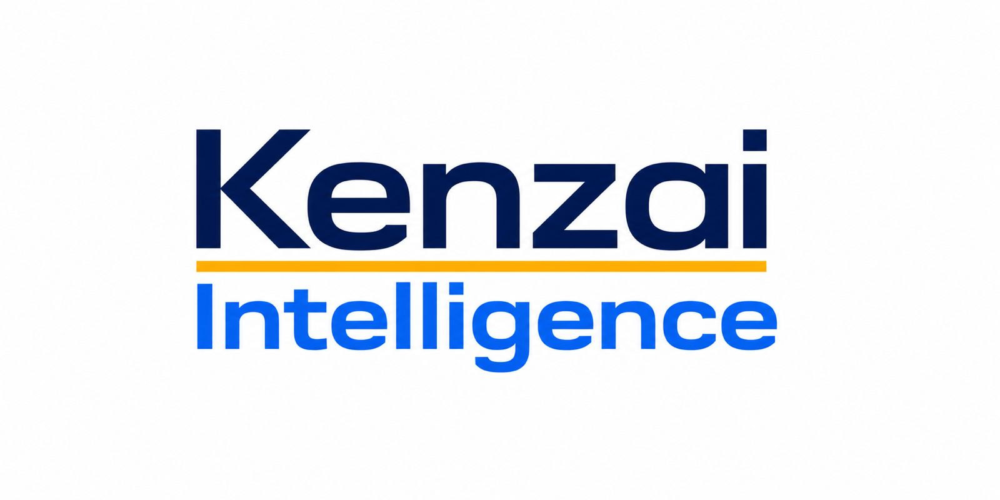

  

<h1 align="center">Practical AI for real operations</h1>

  Kenzai Intelligence designs and deploys governed AI automation for manufacturing and supply-chain teams.

  <a href="https://kenzai.io"><strong>Website</strong></a>
  ·
  <a href="https://kenzai.io/solutions"><strong>Solutions</strong></a>
  ·
  <a href="https://kenzai.io/approach"><strong>Approach</strong></a>
  ·
  <a href="https://kenzai.io/security"><strong>Security</strong></a>
  ·
  <a href="mailto:hello@kenzai.io"><strong>Contact</strong></a>

---

## What we build

Kenzai starts with the work as it actually happens: people, systems, exceptions, approvals, and the points where momentum gets lost. We then design focused AI co-workers and operating systems around the workflows that cost teams time, attention, and margin.

- **Workflow intelligence** for procurement, inventory, finance, reporting, and operations.
- **AI co-workers** that prepare, monitor, coordinate, and recommend the next step.
- **Knowledge systems** that make business context usable without losing governance.
- **Human controls** with explicit approvals, access boundaries, auditability, and escalation paths.

## How we work

1. **Discover** the workflow, bottleneck, and measurable business outcome.
2. **Design** the AI behavior, data boundaries, and human approval points.
3. **Deploy** one focused workflow in a short implementation sprint.
4. **Measure** adoption, quality, operating impact, and exceptions before expanding.

## Engineering principles

- Solve a real operating problem before adding technology.
- Keep accountable business decisions human-owned.
- Make data access, approval boundaries, and failure behavior explicit.
- Prefer small measurable deployments over broad unproven transformation.
- Treat reliability, security, observability, and documentation as product work.

## Working with us

Most of our product and client delivery repositories are private. Public repositories and technical resources will appear here when they are ready for external use.

To discuss a manufacturing or supply-chain workflow, visit [kenzai.io](https://kenzai.io) or email [hello@kenzai.io](mailto:hello@kenzai.io).

---

  

AI that moves the work forward while people stay in control.

